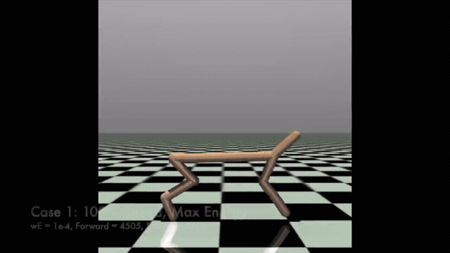

# Locomotion · speed and effort

A portfolio experiment exploring the tradeoff between forward progress and the energy objective in a HalfCheetah simulation.

[Watch the full demonstration ↗](https://aravsportfolio.com/?project=robot-dog-locomotion) · [Original experiment notes](docs/experiment-notes.md)

## Experiment idea

Train PPO policies with different energy penalties, evaluate forward progress and effort separately, then select an efficient policy that retains a minimum fraction of the fastest policy’s forward progress. The simulator’s energy objective is not a physical battery measurement.

## Source availability

The recorded demonstration and original experiment notes are preserved here. The file currently named [`morl_halfcheetah_PPO.py`](morl_halfcheetah_PPO.py) contains a **Fetch pick-and-place SAC + HER experiment**, rather than the HalfCheetah PPO implementation. It cannot reproduce the locomotion demonstration. The matching locomotion training source and model weights are not included in this repository.

For the robot-arm implementation with matching documentation, see [RobotArm_RL](https://github.com/AravBhargava05/RobotArm_RL).
